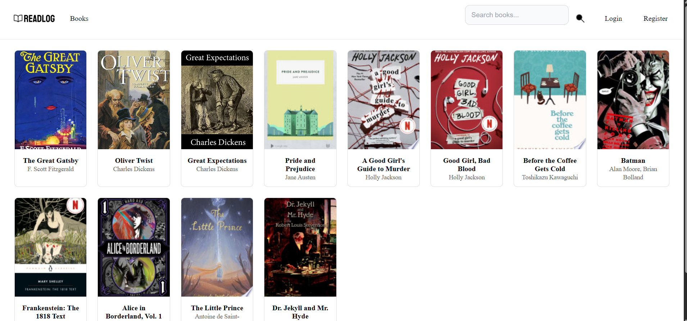

# ReadLog

ReadLog is a responsive web application for personal book logging and reading management. Built as a university project, it lets users catalogue books, track reading progress and organise their own library.

**Live demo:** (will be added once I fix the issues with my deployment)

## Features

- User accounts: register, log in and log out [adjust if different]
- Add, view, edit and delete books in a personal library (full CRUD)
- Track reading status and progress [e.g. want to read / reading / finished]
- Write and manage reviews for books
- Search for books using the Google Books API

## Tech Stack

- **Backend:** Python, Django
- **Frontend:** HTML, CSS, Django templates
- **Database:** SQLite
- **External API:** Google Books API
- **Deployment:** -----

## Project Structure

- `accounts/` – user registration and authentication
- `books/` – book library and reading progress
- `reviews/` – book reviews
- `core/` – [shared pages / base views]
- `templates/`, `static/` – HTML templates and static assets

## What I Learned

- Structuring a Django project into separate apps
- Implementing user authentication and per-user data
- Integrating and handling responses from an external API

## Future Improvements

- other language support
- tests and deployment improvements
- book recommendations
- statistics about read books
- UI improvement

## Author

GitHub: [@sourkristi](https://github.com/sourkristi)
